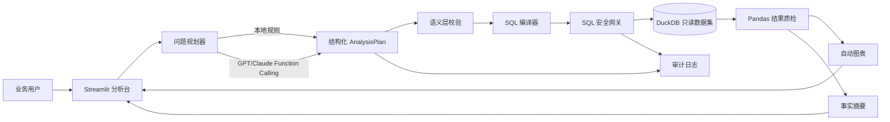

# 系统架构

## 为什么不让大模型直接写任意 SQL

直接 Text-to-SQL 的问题包括字段幻觉、指标口径漂移、危险查询和难以复现。本项目让大模型只提交受 Pydantic 约束的 `AnalysisPlan`，再由确定性的编译器生成 SQL。这样既保留自然语言理解能力，也把计算正确性放在可测试的代码层。

## Function Calling 设计

大模型可调用两个工具：

1. `describe_dataset`：读取已批准的数据字典、指标和维度。
2. `submit_analysis_plan`：提交指标、维度、筛选、排序、Top N 和图表类型。

工具参数进入严格校验，非法字段不会进入数据库执行层。

## SQL 安全

- 只允许单条 `SELECT` 或 `WITH ... SELECT`。
- 禁止 INSERT、UPDATE、DELETE、DROP、ALTER、CREATE、COPY、ATTACH、PRAGMA。
- 禁止 `read_csv`、`read_parquet`、网络和扩展加载函数。
- 只允许白名单表与字段。
- 自动增加结果行数上限。
- 数据库连接使用只读模式。

## 评测层次

- Planner：指标、维度、筛选条件是否识别正确。
- Execution：SQL 能否成功执行并返回合理结果。
- Safety：危险 SQL 是否全部拦截。
- Grounding：回答是否包含查询结果、指标口径和 SQL 依据。
- UX：后续通过任务完成率、耗时和满意度验证。

